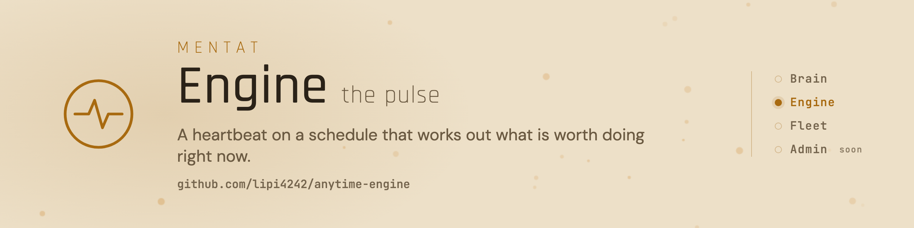

<picture>
  <source media="(prefers-color-scheme: dark)" srcset="assets/banner-dark.png">
  
</picture>

# Mentat Engine

[](https://github.com/lipi4242/anytime-engine/tags)
[](https://github.com/lipi4242/anytime-engine/actions/workflows/ci.yml)
[](LICENSE)
[](https://www.python.org/)
[](README.md)

A legtöbben nem telepítik külön: a [Mentat Brain](https://github.com/lipi4242/mentat-ai-bootstrap/blob/main/README.hu.md) telepítése ezt is beállítja.

A motor ütemezést ad a Mentat-kollégádnak. Elküldi a reggeli összefoglalót és a határidő-emlékeztetőket, amiket különben neked kellene kérned, és minden nyitott ügyet a listán tart, amíg le nem zárul.

- Minden reggel: mi késik, mi esedékes ma és a héten, az ügyeidből, a határidős teendőidből és a határidő-táblázataidból.
- Emlékeztető három nappal minden határidő előtt és aznap, fájlban vagy Telegramon, éjszaka csendben.
- A jóváhagyáshoz kötött üzenet csak akkor megy ki, ha egyezik vele, és egy elvégzett lépés összeomlás után sem ismétlődik.

Fejlesztőknek: a döntés sima Python, modellhívás nélkül, így ugyanabban a pillanatban mindig ugyanaz a terv születik, a munkát pedig az ágensed végzi. Asszisztensenként egy példány fut, tartós systemd- vagy cron-időzítővel, és a `setup --doctor` összeveti a telepített időzítőt azzal, amit a setup írna.

## Telepítés

A legegyszerűbb: kérd meg a Mentat-kollégádat, hogy adja hozzá a motort, ő futtatja a lépéseket. Kézzel, egy már meglévő agyhoz így adod hozzá: nyisd meg a Claude Code-ot abban a mappában, és másold be:

```
Telepítsd az anytime engine-t (github.com/lipi4242/anytime-engine) ebbe a repóba. Futtasd pontosan ezt:
  git clone --depth 1 --branch v0.4.0 https://github.com/lipi4242/anytime-engine /tmp/anytime-engine
  /tmp/anytime-engine/sync-to.sh . --pack cases
  python3 -m anytime_engine.selftest -q
Utána kérdezd meg az időzónámat, és hogy hová menjenek az emlékeztetők (fájl vagy Telegram), és futtasd:
python3 -m anytime_engine.setup --tz <tz> --deliver <file|telegram> --lang hu, az igenem után --install-lal.
```

## Rendszeres feladat = ismétlődő todo

Ehhez a Mentat Admin todo plugin kell, ami még nem nyilvános. Nélküle az `anytime_todo` csomag nem csinál semmit, és a rendszeres feladatok maradnak ott, ahol most vannak (cron-sor vagy concern).

Ha az ágensnek valamit rendszeresen meg kell csinálnia (heti emlékeztető, reggeli kör, havi ellenőrzés), az egy ismétlődő todo a Mentat Admin todo listájában, nem cron-sor és nem saját concern. Az `anytime_todo` csomag minden tickben lekéri az ágensnek kiosztott, esedékes todókat, és a terv elmondja az ágensnek, mi a dolga: a todo címe és leírása maga az utasítás. A todót az ágens csak akkor zárja le, amikor a munka tényleg megtörtént; ismétlődő todónál a lezárás a következő dátumra viszi, tehát az időzítést a todo végzi. Amit nem tud megcsinálni, azt nyitva hagyja, és megjegyzésben leírja, miért.

Cron vagy concern akkor kell, ha a feladatot külső esemény indítja (új levél, webhook, naptárváltozás), vagy minden tickben determinisztikus számítás kell hozzá. Minden más fix ütemű feladat todo.

Egy meglévő cron-feladat átköltöztetése: hozd létre a todót (cím, teljes utasítás a leírásban, `repeat_rule` az ütemhez, következő dátum, ha számít az óra, `due_time` és `tz`, gazdának vagy felelősnek az ágens), nézd meg `python3 -m anytime_todo.cli list`-tel, hogy megjelenik, és ugyanabban a lépésben töröld a régi cron-sort, hogy ne fusson kétszer. A beállítás (`TODO_API`, `TODO_HANDLE`, `TODO_TOKEN_FILE`) és a részletek: [GUIDE.md](GUIDE.md).

## Képesség-napló

A legújabb bejegyzések:

- A rendszeres feladatok ismétlődő teendőként jönnek (a Mentat Admin todo plugin kell hozzá, ami még nem nyilvános)
- Szüneteltethető, így építés közben semmi nem megy ki

Kiadási jegyzetek és frissítési lépések (angolul): [CHANGELOG.md](CHANGELOG.md). Minden változás a teljes csomagban: [képesség-napló](https://github.com/lipi4242/mentat-ai-bootstrap/blob/main/CAPABILITY-LOG.hu.md).

<!-- mentat:family START (a mentat-ai-bootstrap-dev docs/readme/render.py generálja; minden Mentat-repóban azonos) -->
## A Mentat csomag

| Rész | Mit csinál |
|---|---|
| [Mentat Brain](https://github.com/lipi4242/mentat-ai-bootstrap) | Maga a kolléga: memória sima jegyzetekben, gitben, személyiség, biztonsági szabályok, eszközök. |
| [Mentat Engine](https://github.com/lipi4242/anytime-engine) | Az ütemezés: reggeli összefoglaló, határidő-emlékeztetők, és figyel minden nyitott ügyre. |
| [Mentat Fleet](https://github.com/lipi4242/fleet-leader) | Szerveren, éjjel-nappal futtatja az ágenseket, és a Telegramhoz köti őket. |
| Mentat Admin | Kis webalkalmazás az ágens nyilvántartásaihoz. Hamarosan. |
<!-- mentat:family END -->

## Tovább

[Útmutató (angolul)](GUIDE.md) · [Biztonság](SECURITY.md) · [Apache-2.0](LICENSE)
