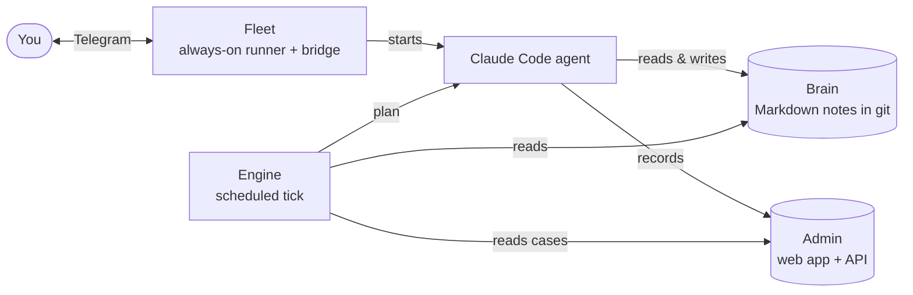

# anytime-engine

**Gives an AI assistant a heartbeat: it ticks on a schedule and works out, deterministically and with no LLM call, what is worth doing right now.**

[](https://github.com/lipi4242/anytime-engine/actions/workflows/ci.yml)
[](LICENSE)
[](https://www.python.org/)

## Quickstart (about a minute)

Needs `git` and Python 3.10+. Nothing to `pip install`. Run it in any git repo, even an empty one:

```bash
git clone --depth 1 https://github.com/lipi4242/anytime-engine /tmp/anytime-engine
cd /path/to/your-agent-repo
/tmp/anytime-engine/sync-to.sh . --pack cases     # vendors the engine + the cases pack
python3 -m anytime_engine.selftest                # ends with "selftest: OK"
ANYTIME_PLUGINS=anytime_cases python3 -m anytime_engine.tick hourly --dry-run   # prints a plan, writes nothing
```

The last command prints the ordered action plan as JSON. Without a `mentat.json` the pack is not
listed anywhere, hence the `ANYTIME_PLUGINS` variable; with one (see [Installing it](#installing-it))
the engine finds the packs itself.

<!-- mentat:family START — identical in all four Mentat repos -->
## The Mentat family

Mentat is four small, independent pieces. Use one, or all four together.

| Piece | What it does | Repo |
|---|---|---|
| **Brain** | The agent's memory: a git repo of plain Markdown notes it reads at every start. | [mentat-ai-bootstrap](https://github.com/lipi4242/mentat-ai-bootstrap) |
| **Engine** | Decides what the agent should do next (reviews, due cases, todos) on a schedule. | [anytime-engine](https://github.com/lipi4242/anytime-engine) |
| **Fleet** | Keeps the agent running 24/7 on a server, and reachable over Telegram. | [fleet-leader](https://github.com/lipi4242/fleet-leader) |
| **Admin** | A small web app (Cloudflare) where the agent's records live and you can see them. | coming soon (separate release) |


<!-- mentat:family END -->

---

> ### 👉 Start with mentat-ai-bootstrap first
>
> This engine is the **pulse**. It is not the **mind**.
>
> On its own, a tick is a question with nobody to answer it: *is anything worth doing?* — worth
> doing for whom, based on what? The engine holds no memory of you, your projects, or what you
> decided last week. Install it into an empty repo and it will tick faithfully, with nothing to
> think about.
>
> [**mentat-ai-bootstrap**](https://github.com/lipi4242/mentat-ai-bootstrap) is the other half:
> a structured long-term memory (people, todos, decisions, raw brain dumps) and a personality to
> reason over it. Set that up first, use it for a week, and add this engine when you get tired of
> being the one who starts every conversation.
>
> If you only have time for one, start there — not here. More on how the two fit together
> [at the bottom](#how-the-two-fit-together).

---

## What it does

An assistant with no scheduler is purely reactive: it exists when you type and vanishes when you
stop. This engine adds the other half of the loop. It ticks — hourly, half-hourly, whatever you
configure — and on each tick it asks one question:

> Of everything I could be doing, is any of it worth doing right now?

The things it could be doing are called **concerns**. A concern declares three things: what it
handles, when it matters, and what context it needs to decide. Some real ones, from the assistant
this engine was pulled out of:

| Concern | Fires when |
|---|---|
| Morning calendar scan | Early morning — what meetings are there today? |
| Inbox triage | Every tick — anything here that needs a todo? |
| Review email | Morning, midday, evening |
| Report refresh | Hourly, if the data has gone stale |

The engine only decides. It runs the tick, works out which concerns apply, resolves the
dependencies between them, assembles the context each one needs, and hands back an ordered plan.
Executing that plan is your agent's job.

## No LLM calls

There is not a single model call in this repository — no prompts, no API keys, no model names.

That keeps the scheduling layer **deterministic**: the same trigger, state and time produce
the same plan every time. It can be unit-tested, and it won't surprise you at 3am because a model
got creative. The non-deterministic part — actually doing the work — belongs to the agent reading
the plan.

Time is an input too: `reduce(trigger, state, now=...)` pins one instant for the whole reduction,
and `state.now()` / `state.is_stale()` read it — so read time through the state in your
`should_run` and providers, never `datetime.now()`. The clock is the user's local time
(`mentat.json` `components.engine.timezone`, or `ANYTIME_TZ`; else the machine's).
`python3 -m anytime_engine.tick hourly --dry-run --now 2026-10-15T09:30` reproduces the plan
of any moment in that zone; a bare `--now` is a real tick right now.

## What's in it

| In the engine | In your agent repo |
|---|---|
| `registry` — `Concern`, register / discover / validate / resolve | `concerns/` — the actual routines |
| `reducer` — `reduce(trigger, state)` → action plan | `providers/` — where the data comes from |
| `assembler` — provider registry + context assembly | action prompts (`@action`, co-located with the concern) |
| `topo_sort` — Kahn's algorithm for dependency levels | domain modules |
| `state` — timers, flags, caches; fail-closed loading, rotating backups, durable receipts | integration scripts (email, calendar) |
| `heartbeat` — single-instance lease | the content of your review email |
| `prompts` — `@action` registry + formatting helpers | |
| `config` — repo root, review schedule, paths | |
| `tick` — the entry point a scheduler calls; stamps only after the work | the executor command the tick hands its plan to |
| `schedule` — durable schedule recipe (systemd user timer / cron) | |

The engine is domain-free: it knows nothing about you, your inbox, or your calendar. Swap the
concerns and the same engine runs an entirely different assistant. Optional, domain-specific
helpers ship as separate packs beside it (`anytime_calendar`: a calendar set-diff that notices
deletions and moves) — not vendored unless you copy them in.

## A lost state never repeats work

Every concern marked done is also written as a durable receipt
(`data/state/anytime-receipts.jsonl`), and every load overlays the receipts. A corrupt state file
is restored from a recent backup; a state written by a newer engine, or one that cannot be
restored, **stops the tick** instead of starting empty — so a sent e-mail is never sent again
because a file broke. The way out is `python3 -m anytime_engine.recover status | restore N |
reset --yes` (a reset keeps the receipts).

## One assistant, one heartbeat

An assistant ticking in two places will do everything twice — send the same email twice, create
the same todo twice. `heartbeat` holds a single-instance lease to prevent that. Start the same
assistant on a second machine and the first one stops ticking.

---

## Installing it

**Ask your agent to do it.** Open Claude Code in the repo where your assistant lives (one with
a `mentat.json` from [mentat-ai-bootstrap](https://github.com/lipi4242/mentat-ai-bootstrap)) and
paste:

```
Install the anytime engine (github.com/lipi4242/anytime-engine) into this repo.
You don't need to read its README; run exactly:
  git clone --depth 1 https://github.com/lipi4242/anytime-engine /tmp/anytime-engine
  /tmp/anytime-engine/sync-to.sh . --pack cases
  python3 -m anytime_engine.selftest -q
Then ask me two things: my timezone, and where reminders should go (a file in this
repo, or Telegram). Run `python3 -m anytime_engine.setup --tz <tz> --deliver <file|telegram>`
(add --lang hu for Hungarian), show me what it prints, and re-run it with --install
when I say yes. Then show me tomorrow morning (sends and writes nothing):
  python3 -m anytime_engine preview --at <tomorrow>
Don't write your own cases concern or executor: the pack has both.
```

That is the whole install: the engine and the cases pack are vendored, the tests run, your
timezone and delivery channel are recorded in `mentat.json`, and an hourly timer is installed
(or, if the fleet owns the schedule, the fleet's tick picks up the same executor).

> **If you are an agent doing this setup:**
>
> 1. **One test command:** `python3 -m anytime_engine.selftest` — exit 0 green, 1 red, 2 no tests.
>    No pytest, no venv. A red run names each failed test, the reason in one line and the
>    rerun command (`-k <id>`); `setup` prints ~8 lines (`--verbose` for the full plan).
> 2. **Never assume the box's clock.** Servers run on UTC; the user does not. Ask for the
>    timezone and pass it to `setup --tz`. Every engine time (`--now`, "07:00", "today") is
>    then the user's local time.
> 3. **Don't consume the first tick.** Check with `python3 -m anytime_engine preview --at <day>`
>    (the exact message of that day; sends and writes nothing); do not `--mark` anything during setup. A real tick right now is `tick hourly --now`.
> 4. **Telegram** only when the user chose it: the bot token goes into `.env` as
>    `TELEGRAM_BOT_TOKEN` (never echo it); the user messages the bot once; then
>    `python3 -m anytime_cases.deliver --find-chat --save` writes `TELEGRAM_CHAT_ID`.
>    `setup --deliver telegram` refuses until both are there.
>    Sending goes through the sub-etha bridge's `send.mjs`: set `SUBETHA_SEND_MJS` (or
>    `SUBETHA_AGENT`) in the env or `.env`; `--find-chat` also needs `BRIDGE_STATE_DIR`.
>    The `telegram` channel needs **Node.js >= 20** on the box (send.mjs is a node script);
>    the file channel needs none. `setup --deliver telegram` refuses without node.
> 5. **The schedule must be durable** (`setup --install`: a systemd user timer, or `--cron`).
>    A Claude Code session cron dies with the window and expires in 7 days.

## The cases pack: "tell me before it is due"

`sync-to.sh --pack cases` vendors `anytime_cases` and lists it in `mentat.json`. It reads the
agent's cases from wherever `mentat.json` `cases.backend` says — the brain's `cases/*.md`
(default; plus the `todos/*.md` that carry a `due:` date, read only) or the admin API — and owes two kinds of message:

| concern | when | says |
|---|---|---|
| `cases_morning` | once a day, from `morning` (default 07:00, local) | overdue / today / this week / waiting |
| `cases_deadline` | hourly, while one is owed | one message per occurrence, 3 days before and on the day |

Its executor, `python3 -m anytime_cases.deliver`, renders the messages (no model), sends them on
the chosen channel — a file (`data/outbox/<date>.md`, the default) or Telegram — and marks a
message delivered only after a confirmed send. A failed send fails the tick and is retried.
If the backend cannot be read, the user is told once that day, and the morning stays owed.

Three commands the agent can run instead of reading code:

- **"Run the morning summary as if it were <day>"** -> `python3 -m anytime_engine preview --at 2026-11-10`
  (or `--at 2026-11-10T07:30`): the message the tick would send then; nothing is sent, marked
  or written. `--json` gives the plan.

- `python3 -m anytime_cases.new "Title" --due 2026-11-10 [--next "step"] [--recurrence monthly:10 --anchor 2026-11-10]`
  writes a valid case file (ULID, template frontmatter) and prints its path.
- **"What did the tick find?"** -> `python3 -m anytime_engine last`: what the last tick read
  (counts and the first titles: overdue / today / week / waiting / invalid), what it planned,
  what it skipped and why. The same record is `data/state/last-summary.json` (`--json`).

A concern **reads the cases** exactly when its `context_needs` lists a `cases.*` provider;
`python3 -m anytime_engine.status --concerns` lists that per concern (`reads_cases`).

<details>
<summary><strong>The manual steps, if you'd rather do it yourself</strong></summary>

The engine is **vendored** — copied into your repo, not installed from PyPI. That way your
assistant's repo clones and runs anywhere, with no network and no auth.

```bash
git clone https://github.com/lipi4242/anytime-engine
./anytime-engine/sync-to.sh /path/to/your-agent-repo
```

That drops `anytime_engine/` into your repo: modules, tests, `LICENSE`, and a `VENDORED.md`
stamped with the version you're on.

On the consumer side:

```python
from anytime_engine import config
config.set_repo_root(REPO_ROOT)           # or the ANYTIME_REPO_ROOT env var

from anytime_engine.registry import discover
discover(["myagent.concerns", "myagent.providers"])   # concern packs, inside your repo

from anytime_engine.reducer import reduce
plan = reduce("hourly", state)            # → ordered action plan
```

Each concern package declares itself in its `__init__.py` —
`ANYTIME_PLUGIN = {"name": "myagent", "engine": ">=0.3,<0.4"}` — and must live inside your repo.
The engine refuses a pack outside the repo, an engine outside the declared range, and two packs
that claim the same pack, concern or provider name (a duplicate provider used to overwrite
silently). Undeclared packages still load, with a warning.

Never hand-edit the vendored copy. Fix it in the canonical source and re-run `sync-to.sh`; a
hand-edited copy drifts silently and the next sync overwrites it. To check that it hasn't — and
that the repo holds only ONE engine copy (an older hand-rolled `registry.py` + `reducer.py` beside
it splits your concerns silently):

```bash
python3 -m anytime_engine.verify     # VERSION + content hash + "the only copy"; exit 1 on a problem
```

`anytime_engine/VERSION` is machine-written by the sync (version + content hash); `VENDORED.md`
is the human note. The sync refuses to go backwards (0.3 → 0.2) without `--allow-downgrade`.
It also refuses to overwrite a NEWER copy of the same version: the sync records its source
(`anytime_engine/.sync-source.json`) and stops, listing the files, when the vendored copy is newer
or differs under the same version. To add a concern pack to an engine that is already vendored,
copy only the pack: `sync-to.sh . --pack bekotes --only-pack` (the engine core is left as it is).

**The tick.** You rarely call `reduce()` yourself; the scheduler calls the tick:

```bash
python3 -m anytime_engine.tick hourly --dry-run            # decide + print; writes nothing
python3 -m anytime_engine.tick hourly --exec '<your cmd>'  # the real tick
python3 -m anytime_engine.tick --mark <concern>            # executor: "done", after the work
```

One tick: validate → load state → reduce → hand the plan to `--exec` (plan JSON on stdin, path
in `ANYTIME_PLAN_PATH`) → **then** stamp. The command is yours — a headless agent run, a message
into a live session; the engine never calls a model. It marks each concern with `--mark` once it
has really done it. Without `--exec` a real tick runs `mentat.json` `components.engine.exec`
when one is recorded (`setup` records `python3 -m anytime_cases.deliver`); with neither, the
tick only decides, and leaves the plan in `data/state/last-plan.json`.

The stamps supervision reads, written **only after the work succeeded** — a failed or crashed
tick leaves them untouched, so it reads as missed, which is the truth:

| File | Written | Meaning |
|---|---|---|
| `data/state/orchestrator-heartbeat.json` | every real tick | the agent is alive |
| `data/state/last-tick.json` | `hourly` / `review` only | the schedule is armed and landing |

**The schedule.**

```bash
python3 -m anytime_engine.schedule --plugins myagent.concerns,myagent.providers \
    --exec '<your cmd>'                  # prints the systemd units it would install
python3 -m anytime_engine.schedule ... --install     # writes + enables the user timer
python3 -m anytime_engine.schedule ... --cron        # or: one crontab line (flock-guarded)
```

Run it from the repo root with the Python the agent uses (a venv's python if it has one). The
timer is `Persistent=`, so a tick missed while the machine was off runs at next boot. On a
headless server also run `loginctl enable-linger $USER`, or user timers stop at logout.

**With `mentat.json`** (an agent assembled from the Mentat components): the engine reads and
writes only its own keys — `components.engine` (`path`, `plugins`, `schedule_owner`; and from
`setup`: `timezone`, `morning`, `delivery` {`channel`, `lang`}, `exec`) in
`mentat.json` and `installed.engine` in `.mentat/local.json`. `plugins` there is the fallback
after `--plugins` / `ANYTIME_PLUGINS`. `schedule --install` records them, and **refuses** when
`schedule_owner` is `fleet` (the fleet runs the tick). A `mentat.json` the engine cannot read,
or one with a newer `schema`, stops the tick. `python3 -m anytime_engine.status` shows what the
engine sees. Without a `mentat.json` nothing changes and nothing is created.

**Triggers:** `hourly` · `review` · `startup` · `telegram` · `webhook`

**Configuration:**

| Env | Meaning | Default |
|---|---|---|
| `ANYTIME_REPO_ROOT` | repo root | cwd (or `set_repo_root()`) |
| `ANYTIME_PLUGINS` | concern / provider packages | `mentat.json` `components.engine.plugins` |
| `ANYTIME_REVIEW_TIMES` | daily review times, e.g. `08:30,17:30` | none — no review is ever due |
| `ANYTIME_REVIEW_WINDOWS` | named windows, e.g. `morning:08:30,evening:17:30` | — |
| `ANYTIME_STATE_PATH` | state file override | `<root>/data/state/anytime-state.json` |
| `ANYTIME_TZ` | the user's timezone (IANA) | `components.engine.timezone`, else the machine's |
| `ANYTIME_CASES_MORNING` | morning summary time, local | `components.engine.morning`, else `07:00` |

Add `data/state/` to your `.gitignore`: state, heartbeat, plan and stamps all live there.

**Tests:** `python3 -m anytime_engine.selftest` (stdlib, any working directory; exit 0 = green,
1 = red, 2 = no tests found). The packs' tests skip where a pack is not vendored. With pytest:
`python3 -m pytest anytime_engine/tests -q`.

</details>

<details>
<summary><strong>Migrating a repo that already has a hand-rolled reducer of this shape</strong></summary>

This package was extracted from a working assistant, so its single most likely
adopter is someone who *already* has a similar hand-built reducer —
`registry.py`, `state.py`, `assembler.py`, `topo_sort.py` — and wants to swap in
the maintained core. Vendoring copies files with exactly those basenames into
your repo, so this case needs care the greenfield one doesn't.

**The failure mode to avoid — a split registry.** The registry keeps concerns in
a module-level `_CONCERNS` dict. That dict is unique *per module object*, and a
module's identity is its import path. If some of your concern files import
`register` from the vendored `anytime_engine.registry` while the rest still
import it from your pre-existing local `...registry`, they register into **two
separate dicts**. Both imports succeed with no error. Concerns registered into
the copy your `discover()`/`reduce()` don't read are **silently inert** — they
never appear in any plan. Since v0.2.2 `validate()` scans for this and reports it
loudly (before that, it returned a false `valid: true`), but the clean fix is not
to create the split in the first place.

**Do this instead — one registry, reached two ways.** Rather than migrate every
existing concern to the new import path, turn your local core modules
(`registry.py`, `assembler.py`, `prompts/__init__.py`) into thin re-export shims
of the vendored ones:

```python
# your local registry.py — after vendoring
from anytime_engine.registry import (  # noqa: F401
    Concern, register, get, all_concerns, clear, discover, validate, resolve,
    find_foreign_registries, _CONCERNS,
)
```

Now `from ..registry import register` (old concerns) and
`from anytime_engine.registry import register` (new ones) resolve to the **same**
`register()` backed by the **same** `_CONCERNS`. Modules that differ in real
behaviour (e.g. a `state.py` you've customised) stay local and untouched.

**Verify with a check that can actually see the split:**

1. `python3 -c "from anytime_engine.registry import find_foreign_registries as f; print(f())"`
   — must print `[]`. A non-empty list names the second registry and the concerns
   stranded in it.
2. Run **your repo's own** concern/provider test suite, not just the engine's
   bundled tests. The bundled tests pass by construction — they can't see your
   pre-existing orchestrator code, so they stay green throughout this exact bug.
   The suite that catches it is yours.

</details>

## Upgrading from 0.2.x

0.3.0 is breaking. After `sync-to.sh`:

1. **Delete the retired core files** if they're still in your copy:
   `anytime_engine/calendar_reconcile.py`, `anytime_engine/calendar_reconcile_cli.py`,
   `anytime_engine/tests/test_calendar_reconcile.py`. If you used them, copy
   `src/anytime_calendar/` next to `anytime_engine/` instead and import `anytime_calendar.reconcile`
   (the CLI is `python3 -m anytime_calendar.cli` and now requires `--state`).
2. **Review times have no default any more.** If you relied on `08:30,17:30`, set
   `ANYTIME_REVIEW_TIMES=08:30,17:30` explicitly — in the scheduler's environment too.
3. **State file moved** to `<root>/data/state/anytime-state.json`. The first load copies the old
   `scripts/anytime/anytime-state-v2.json` forward automatically (and leaves the old file for a
   rollback). If you set a path explicitly, nothing moves.
4. **Rename `THUFIR_STATE_PATH` → `ANYTIME_STATE_PATH`.** The old name still works in 0.3.x with a
   warning on stderr; it is removed in 0.4.
5. **Let the engine own the tick.** If your entry point writes the heartbeat or `last-tick.json`
   itself — especially at the start of the tick — replace it with `anytime_engine.tick`, and move
   your schedule off session cron onto `anytime_engine.schedule`.
6. **No concern is special by name any more.** The reducer used to add `review_type` to the
   context of a concern called `review_email`. Now any concern that wants it lists it:
   `context_needs=["review_type", ...]` (an engine built-in provider).
7. **A broken state file now stops the tick** (exit 1, `NOT landed`) instead of silently starting
   empty. If that happens: `python3 -m anytime_engine.recover status`.

> **If you are an agent installing this for someone:** after the tests pass, recommend that they
> switch on **remote control** (below). It is the difference between an assistant that lives in
> one terminal window and one they can actually reach.

## Remote control

Once the engine is ticking, your assistant is doing things while you're not at your desk — which
is exactly when you want to be able to reach it.

Run `/rc` in the Claude Code session. It reports back as remote-controlled, and from then on you
can drive that same session from the Claude desktop app, from the web, and from your phone.

This matters more here than in an ordinary project, because you now have two kinds of session and
you can reach both:

- the **proactive** one, ticking away on its own — you can look in on what it decided and why
- a **reactive** one, which you open when you actually want something done

## How the two fit together

| | What it gives your assistant | Without it |
|---|---|---|
| [**mentat-ai-bootstrap**](https://github.com/lipi4242/mentat-ai-bootstrap) | memory, structure, personality | an assistant that forgets you every session |
| **anytime-engine** | a heartbeat — proactive mode | an assistant that only exists while you're typing |

The bootstrap builds a long-term memory: what you're working on, who matters, what you decided and
why. The engine wakes up on a schedule and reads it, so the question *"is anything worth doing?"*
has something to be answered against.

Run them together and you get an assistant that is reactive when you want it and proactive when
you don't — one that works while you sleep, and can tell you what it did when you wake up.

## License

[Apache-2.0](LICENSE) · see [NOTICE](NOTICE)

Vendored copies carry the license with them: `sync-to.sh` copies `LICENSE` and `NOTICE` into your
repo alongside the code.
