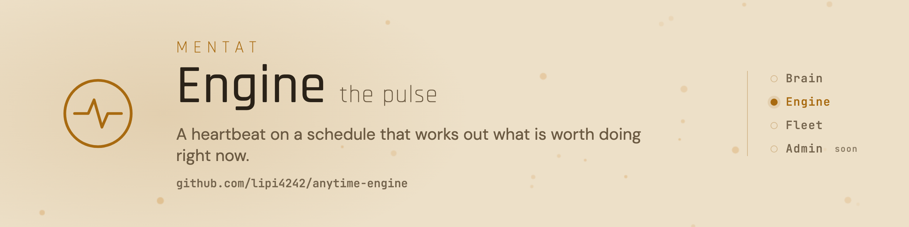

<picture>
  <source media="(prefers-color-scheme: dark)" srcset="assets/banner-dark.png">
  
</picture>

# Mentat Engine

[](https://github.com/lipi4242/anytime-engine/tags)
[](https://github.com/lipi4242/anytime-engine/actions/workflows/ci.yml)
[](LICENSE)
[](https://www.python.org/)
[](README.hu.md)

Most people do not install this separately: the [Mentat Brain](https://github.com/lipi4242/mentat-ai-bootstrap) install already sets it up.

The engine gives your Mentat colleague a schedule. It sends the morning summary and the deadline reminders you would otherwise have to ask for, and keeps each open case on the list until it is closed.

- Every morning: what is late, due today and due this week, from your cases, dated todos and deadline spreadsheets.
- A reminder three days before each deadline and one on the day, in a file or on Telegram, and quiet at night.
- A message tied to something you approved goes out only when it matches it, and a finished step is not repeated, even after a crash.

For developers: the decision is plain Python with no model call, so the same moment always gives the same plan, and your agent does the work. One instance runs per assistant on a durable systemd or cron timer, and `setup --doctor` compares the installed timer with what setup would write.

## Install

Easiest: ask your Mentat colleague to add the engine; it runs these steps for you. By hand, to add it to a brain you already have, open Claude Code in that folder and paste:

```
Install the anytime engine (github.com/lipi4242/anytime-engine) into this repo. Run exactly:
  git clone --depth 1 --branch v0.3.1 https://github.com/lipi4242/anytime-engine /tmp/anytime-engine
  /tmp/anytime-engine/sync-to.sh . --pack cases
  python3 -m anytime_engine.selftest -q
Then ask me my timezone and where reminders should go (a file or Telegram), and run
python3 -m anytime_engine.setup --tz <tz> --deliver <file|telegram>, with --install once I say yes.
```

## Feature log

Newest entries:

- Deadlines straight from a spreadsheet
- Scheduled messages go out only when they match what you approved
- Tells you if its timer was changed by hand
- Faster install

Release notes and upgrade steps: [CHANGELOG.md](CHANGELOG.md). Every change across the kit: [capability log](https://github.com/lipi4242/mentat-ai-bootstrap/blob/main/CAPABILITY-LOG.md).

<!-- mentat:family START (generated by docs/readme/render.py in mentat-ai-bootstrap-dev; identical in every Mentat repo) -->
## The Mentat kit

| Part | What it does |
|---|---|
| [Mentat Brain](https://github.com/lipi4242/mentat-ai-bootstrap) | The colleague itself: memory as plain notes in git, personality, safety rules, tools. |
| [Mentat Engine](https://github.com/lipi4242/anytime-engine) | The schedule: morning summary, deadline reminders, and a watch on every open case. |
| [Mentat Fleet](https://github.com/lipi4242/fleet-leader) | Runs agents around the clock on a server and connects them to Telegram. |
| Mentat Admin | A small web app for the agent's records. Coming soon. |
<!-- mentat:family END -->

## More

[Guide](GUIDE.md) · [Security](SECURITY.md) · [Apache-2.0](LICENSE)
